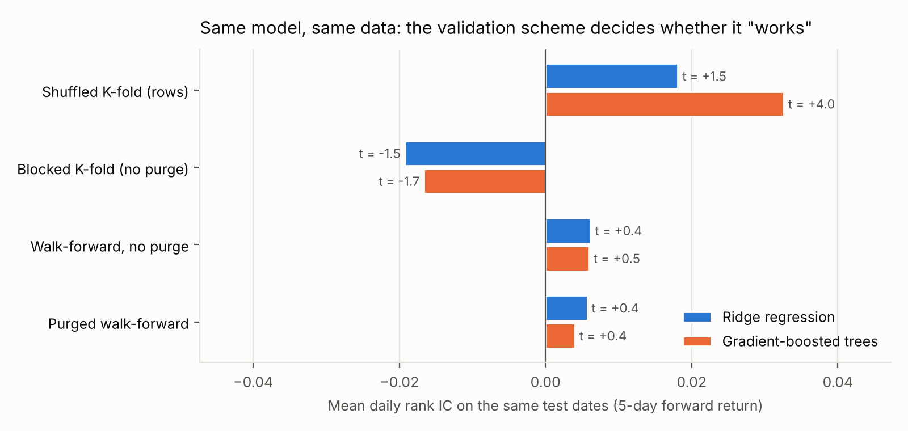
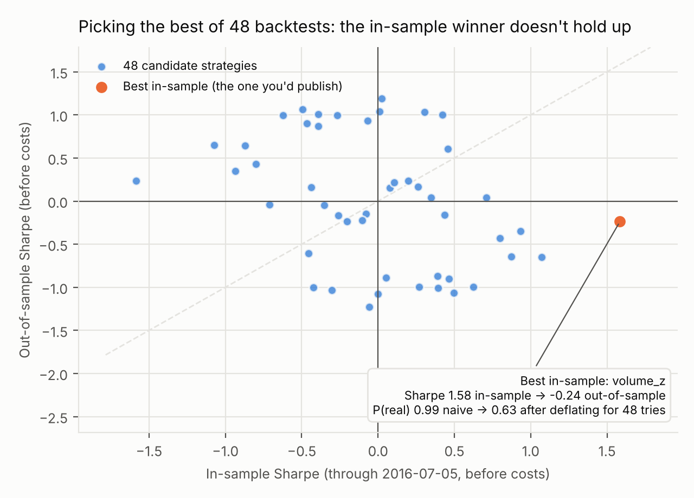

# How Data Leakage Fakes Alpha

**Measuring how much look-ahead bias, leaky cross-validation and multiple testing inflate a stock-trading backtest, and building the checks that catch them.**

A model with no real edge can look like a winner if it is evaluated the wrong way. This project takes one universe of 483 S&P 500 stocks (daily prices, Feb 2013 to Feb 2018), one set of eight simple price-based features, and two models (ridge regression and gradient-boosted trees). It then changes **only the evaluation protocol** and measures how much each mistake inflates the result.

| What changed | Same model, honest protocol | With the mistake |
| --- | --- | --- |
| Shuffled K-fold instead of purged walk-forward (gradient-boosted trees, 5-day returns) | IC +0.004, t = 0.4 | IC +0.033, **t = 4.0** |
| One `shift(-1)` bug in one feature | Sharpe +0.02 before costs | **Sharpe +38** |
| Trading at the same close that produced the signal | IC +0.003 | IC +0.008 |
| Reporting the best of 48 strategies | P(true Sharpe > 0) = 0.99 | **0.63 after deflation; out-of-sample Sharpe −0.24** |

The honest answer for these features is that **there is no tradable edge after costs**: the best honest model loses money once 5 bps per trade is charged. That is the expected result for well-known price signals on large, liquid stocks. The point of the project is that the leaky protocols would have said otherwise.

## The four leaks

### 1. Look-ahead in features: caught by a truncation audit

A feature is point-in-time only if its value at date *t* does not change when every row after *t* is deleted. `leakbt.audit.truncation_audit` checks exactly that, at 20 random dates, without reading the code.

| Feature | Dates checked | Dates where value changed | Verdict |
| --- | --- | --- | --- |
| `ret_1`, `ret_5`, `ret_21`, `mom_252_21`, `vol_21`, `range_5`, `volume_z`, `dist_high_21` | 20 each | 0 | point-in-time |
| `ret_5_offbyone` (planted `shift(-1)` bug) | 20 | 20 | **leaks future data** |
| `vol_21_fullsample_z` (z-scored with whole-history mean and std) | 20 | 20 | **leaks future data** |

Added to an otherwise honest pipeline, the off-by-one feature produces a Sharpe ratio of about 38 for both models. The full-sample z-score also leaks, but here its effect is negligible: the features are re-ranked across stocks every day, which removes most of what it leaked. **Not every leak inflates results, which is why the audit checks the mechanism rather than waiting for a suspicious number.**

### 2. Leaky cross-validation: the subtle one

With a 5-day forward-return target, neighbouring days share four of their five days of return. Shuffled K-fold puts those near-duplicates on both sides of the split.



* **Shuffled K-fold** made gradient-boosted trees look statistically significant (t = 4.0, Newey-West). The more flexible the model, the more it exploits the overlap: ridge only reaches t = 1.5.
* **Purged walk-forward** trains only on the past, drops training rows whose targets overlap the test window, and leaves a 5-day embargo. The same models score t ≈ 0.4: no detectable skill.
* **Blocked K-fold** trains on data from *after* the test block. Here that happened to hurt (negative IC), a reminder that future-trained models are wrong in both directions, not just optimistic.

This leak is more dangerous than the off-by-one bug because the inflated number (IC 0.03) is believable.

### 3. Execution look-ahead

Computing a signal from today's close and assuming you also *trade* at that close is impossible in practice. Moving execution to the next open, as the honest pipeline does, cuts the IC by more than half for both models (ridge 0.012 → 0.005, trees 0.008 → 0.003).

### 4. Multiple testing: the deflated Sharpe ratio

I tried 48 simple strategies: 8 features × long/short direction × 3 portfolio sizes. Each was judged on data through July 2016 and then tested afterwards, before costs to isolate selection bias.



The in-sample winner (long high relative volume) had a Sharpe of 1.58 and a 99.3% probabilistic Sharpe ratio, which looks like a discovery. The **deflated Sharpe ratio** (Bailey & López de Prado, 2014) accounts for having picked it out of 48 tries. With that many tries, the best of 48 skill-less strategies would be expected to reach an annualized Sharpe of about 1.37 by luck alone, so the winner's probability of being real drops to 63%. Out of sample it lost money (Sharpe −0.24). Across all 48 trials, in-sample and out-of-sample Sharpe were *negatively* correlated (−0.36).

## Honest results (purged walk-forward, next-open execution)

Test period: Feb 2015 to Feb 2018 (753 trading days), models retrained monthly on all prior data, long top decile / short bottom decile, equal-weighted, dollar-neutral.

| Strategy | Mean IC (t) | Sharpe before costs | Sharpe after 5 bps | 95% CI (after costs) | Avg daily turnover |
| --- | --- | --- | --- | --- | --- |
| Ridge | +0.005 (0.65) | −0.06 | −1.33 | [−2.33, −0.28] | 81% |
| Ridge, 5-day smoothed signal | +0.006 (0.76) | −0.08 | −0.54 | [−1.60, +0.62] | 31% |
| Gradient-boosted trees | +0.003 (0.65) | +0.02 | −1.91 | [−3.03, −0.76] | 105% |
| Gradient-boosted trees, smoothed | +0.004 (0.67) | −0.13 | −0.75 | [−1.82, +0.44] | 41% |

Confidence intervals use a stationary block bootstrap (2,000 resamples, mean block 10 days) so autocorrelation is kept. Smoothing the predictions with a 5-day exponential average cuts turnover by about 60%, but there is no edge underneath for it to save.

## Engineering

* **`leakbt/`**: Python package. `features.py` (point-in-time features, next-open targets), `audit.py` (truncation test), `validation.py` (shuffled/blocked K-fold, purged walk-forward with embargo), `models.py`, `portfolio.py`, `stats.py` (Sharpe, Newey-West t-stats, stationary bootstrap, probabilistic and deflated Sharpe).
* **`cpp/fastbt.cpp`**: C++17 kernels for the daily long-short backtest and the daily rank IC, exposed through pybind11. On the full 1,259 × 483 panel they run about **4× faster** than the NumPy version, with identical results (max difference 2e-18). If the extension isn't compiled, the package falls back to NumPy automatically.
* **`tests/`**: 15 pytest tests. They cover the audit (passes real features, catches both planted bugs), purge gaps, the C++ and NumPy versions matching each other and scipy's Spearman, dollar neutrality, and that deflation lowers confidence.
* Portfolio membership is decided from the scores alone. A stock with a missing future return is still held and earns 0, so the backtest never peeks at which stocks have future data.

## Run it

```bash
pip install -e .                       # builds the C++ extension (needs a C++17 compiler)
python scripts/download_data.py        # ~30 MB from github.com/plotly/datasets
python -m pytest -q                    # 15 tests, < 1 s
python -m experiments.run_all          # all experiments + figures, ~2 min
```

## Limitations

* **Survivorship bias.** The dataset contains only stocks that were in the S&P 500 in early 2018; companies that were dropped or went bankrupt earlier are missing. This typically flatters long-only and momentum results; correcting it needs point-in-time index membership, which this free dataset does not have.
* Prices are split-adjusted but not dividend-adjusted. I dropped about a dozen daily moves above 40% (spin-offs and data errors, e.g. eBay on the PayPal spin-off).
* Costs are a flat 5 bps per unit of turnover. No market impact, borrow fees or short-sale constraints.
* The deflated Sharpe ratio assumes the trials are independent. Trying both directions of each feature produces mirror-image pairs, so 48 overstates the effective number of independent trials somewhat.
* Five years of daily data on one universe. The conclusions are about evaluation protocols, not about whether these signals work elsewhere.

## References

* M. López de Prado, *Advances in Financial Machine Learning* (2018), ch. 7 (purged cross-validation, embargo).
* D. Bailey and M. López de Prado, "The Deflated Sharpe Ratio," *Journal of Portfolio Management* (2014).
* D. Politis and J. Romano, "The Stationary Bootstrap," *JASA* (1994).
* W. Newey and K. West, "A Simple, Positive Semi-Definite, Heteroskedasticity and Autocorrelation Consistent Covariance Matrix," *Econometrica* (1987).
